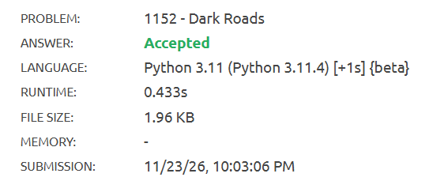

# 1152- Estradas Escuras

**Problema:** [Estradas Escuras](https://judge.beecrowd.com/en/problems/view/1152)  

---

## 📌 Descrição do Problema

> O problema consiste em encontrar a maior economia possível na iluminação das estradas de Byteland, desligando a iluminação de algumas delas sem comprometer a conexão entre os cruzamentos.

> Como todos os cruzamentos precisam continuar conectados entre si por caminhos iluminados, devemos manter um conjunto mínimo de estradas que garanta essa conectividade. O objetivo é calcular a diferença entre o custo total de todas as estradas e o custo mínimo necessário para manter a cidade conectada.

---

## 💡 Abordagem

> A principal percepção é que o problema pode ser resolvido utilizando uma Árvore Geradora Mínima. Para isso, utilizei o algoritmo de Prim, que encontra o conjunto de arestas de menor peso capaz de conectar todos os vértices do grafo.

> A solução foi dividida em três etapas: Construção do grafo -> Soma do custo total -> Cálculo da árvore geradora mínima. Ao final, subtraio o custo da árvore geradora mínima do custo total das estradas. O resultado representa a economia máxima diária possível.

---

## ❌ O Que Não Funcionou

> Inicialmente, considerei utilizar uma estratégia gulosa que selecionava as estradas de menor comprimento individualmente, tentando manter apenas aquelas que fossem necessárias para conectar os cruzamentos. O problema dessa abordagem é que escolher as menores estradas isoladamente não garante que todos os cruzamentos permaneçam conectados. Lembrei então do algoritmo de Prim, que achava a árvore geradora mínima do grafo, justamente o que precisava

---

## 📊 Análise de Complexidade

### Tempo

> Sendo V número de vértices e E o número de arestas, temos:
> Construção do grafo O(V + E)
> Soma das arestas O(E)
> Algoritmo de Prim O(ElogE)

> Complexidade total = O(V + ElogE)

### Espaço

> O(V + E), considerando grafo, dicionário de vértices visitados, fila de prioridade

## 🔍 Corretude

> AA solução é correta porque uma Árvore Geradora Mínima conecta todos os vértices de um grafo conectado utilizando exatamente V−1 arestas, com o menor custo total possível. O algoritmo de Prim garante essa propriedade ao selecionar, a cada iteração, a aresta de menor peso que conecta um vértice já visitado a um vértice ainda não visitado. Dessa forma, ao finalizar, temos o conjunto de estradas de menor custo que mantém todos os cruzamentos conectados.

---

## 🚀 O Que Poderia ser Melhorado

> Outra possibilidade seria utilizar o algoritmo de Kruskal com Union-Find. Essa abordagem também encontra uma Árvore Geradora Mínima e pode ser bastante eficiente para grafos com muitas arestas.

---

## 📸 Evidência de Submissão

> 
