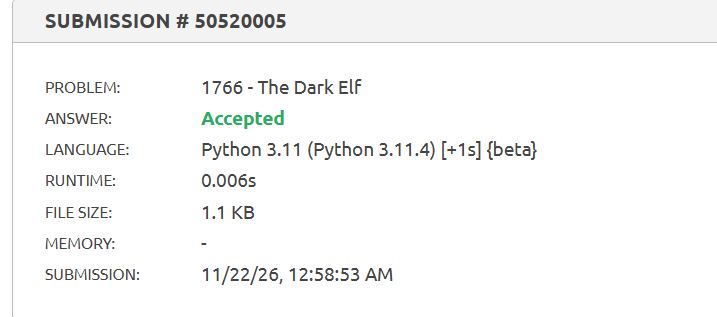

# 1766 - O Elfo Negro

**Problema:** [O Elfo Negro](https://judge.beecrowd.com/pt/problems/view/1766)  

---

## 📌 Descrição do Problema

> O problema consiste em selecionar as n renas mais aptas para o serviço, considerando seus atributos: peso, idade, altura e nome.

>A classificação deve seguir uma ordem de prioridade:
> 1. Maior peso primeiro;
> 2. Menor idade primeiro;
> 3. Menor altura primeiro;
> 4. Nome em ordem alfabética,

---

## 💡 Abordagem

> Utilizei um dicionário para armazenar as renas, tendo seus nomes como chaves e seus respectivos atributos (peso, idade e altura) como valores.
> Para realizar a classificação, implementei uma função de ordenação personalizada (criterio_ordenacao), que retorna uma tupla com os critérios de comparação
> Como o Python ordena tuplas considerando seus elementos da esquerda para a direita, foi possível representar todas as prioridades em uma única função. Utilizei o sinal negativo no peso para inverter sua ordem, fazendo com que os maiores valores apareçam primeiro, enquanto os demais critérios permanecem em ordem crescente.
> Após ordenar as renas com sorted(), iterei o resultado e exibi somente a quantidade solicitada pelo problema.

---

## ❌ O Que Não Funcionou

> Inicialmente, tentei ordenar as renas separadamente por cada critério. Primeiro, ordenava pelo peso, depois pela idade, em seguida pela altura e, por último, pelo nome.

>Porém, essa abordagem não funcionava corretamente, pois cada nova ordenação sobrescrevia a ordem estabelecida anteriormente. Assim, ao finalizar o processo, as renas estariam ordenadas apenas pelo último critério aplicado (nome), desconsiderando as prioridades anteriores.

---

## 📊 Análise de Complexidade

### Tempo

> Seja n o número total de renas de um cenário.
> - Leitura e armazenamento das renas: O(n).
> - Ordenação das renas: O(n log n), utilizando o algoritmo de ordenação do Python.
> - Impressão das k renas selecionadas: O(k), sendo k a quantidade solicitada.
> Portanto, a complexidade é O(n log n), pois a ordenação é a operação dominante.

### Espaço

> O dicionário armazena os atributos de todas as n renas, ocupando O(n) de espaço.

> Além disso, a ordenação com sorted() cria uma nova estrutura contendo os elementos ordenados, também ocupando O(n).

> Portanto, a complexidade espacial é O(n).

## 🔍 Corretude

> O algoritmo garante a classificação correta das renas porque a função criterio_ordenacao representa fielmente as prioridades estabelecidas pelo enunciado.

> Dessa forma, após a ordenação, as primeiras k renas correspondem exatamente às mais aptas segundo os critérios definidos pelo problema.

---

## 🚀 O Que Poderia ser Melhorado

> Uma possível melhoria seria utilizar uma lista de tuplas em vez de um dicionário, armazenando o nome e os atributos de cada rena em uma única estrutura.

> Isso evitaria a necessidade de utilizar os nomes como chaves e permitiria realizar a ordenação diretamente sobre a lista.

---

## 📸 Evidência de Submissão

> 
