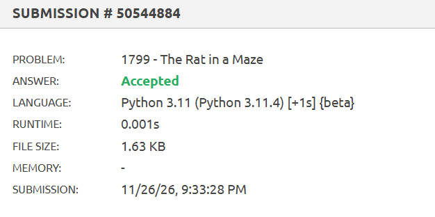

# 1799 - O Rato no Labirinto

**Problema:** [O Rato no Labirinto](https://judge.beecrowd.com/pt/problems/view/1799)  

---

## 📌 Descrição do Problema

> O problema consiste em encontrar a menor quantidade de pontos que devem ser percorridos por IBO para realizar seu percurso dentro de um labirinto.

> O percurso deve obrigatoriamente começar em Entrada, passar pelo ponto onde está o queijo (*) e terminar em Saida.

> As conexões entre os pontos são bidirecionais, ou seja, é possível percorrê-las nos dois sentidos.

> Além disso, caso IBO passe pelo mesmo ponto duas vezes, uma durante a ida e outra durante a volta, esse ponto deve ser contabilizado duas vezes.
---

## 💡 Abordagem

> Utilizei um dicionário para representar o grafo, no qual cada ponto funciona como uma chave e seus vizinhos são armazenados em uma lista. Como as conexões são bidirecionais, cada ligação é adicionada aos dois pontos.
> Para encontrar os menores caminhos, implementei o algoritmo BFS (Busca em Largura). Realizo duas buscas independentes:
> - A primeira encontra o menor caminho entre Entrada e o queijo (*).
> - A segunda encontra o menor caminho entre o queijo (*) e Saida.
> Por fim, somo os tamanhos dos caminhos e subtraio 2 para desconsiderar os pontos iniciais e encontro o número mínimo de pontos pelo qual IBO precisa passar.

---

## ❌ O Que Não Funcionou

> Inicialmente, tentei encontrar o menor caminho diretamente entre entrada e saida, utilizando uma única busca BFS. Mas, percebi que essa abordagem não garantia que IBO passaria pelo queijo durante o percurso, podendo encontrar um caminho mínimo que não atendesse à exigência do problema.
> Dessa forma, utilizando duas buscas BFS independentes, consegui encontrar o menor caminho para cada trecho e somar seus resultados, garantindo que todas as condições do enunciado fossem respeitadas.

---

## 📊 Análise de Complexidade

### Tempo

> Seja V a quantidade de vértices e E a quantidade de arestas do grafo.

> Construção do grafo: O(V + E).
> Primeira busca BFS : O(V + E).
> Segunda busca BFS : O(V + E).
> Reconstrução dos caminhos: O(V) no pior caso.

> Complexidade total: O(V + E)

### Espaço

> O dicionário utilizado para representar o grafo armazena os vértices e suas conexões, ocupando O(V + E).

> Além disso, cada execução da BFS utiliza:
> - Uma fila (deque) para armazenar os pontos que ainda serão explorados.
> - Um dicionário (pais) para registrar os pontos visitados e seus respectivos predecessores.
> - Uma lista para reconstruir o caminho encontrado.
> Essas estruturas ocupam O(V) de espaço.

> Complexidade total: O(V + E)

## 🔍 Corretude

> O algoritmo garante o resultado mínimo porque o grafo é não valorado, ou seja, todas as ligações possuem o mesmo custo.
> Nesse tipo de grafo, a BFS explora os pontos em ordem crescente de distância em relação à origem. Dessa maneira, quando o destino é encontrado, o caminho reconstruído utilizando o dicionário pais corresponde a um dos menores caminhos possíveis.
> Como o percurso obrigatório passa pelo queijo, podemos separar o problema em dois trechos independentes: Entrada até * e * até Saida.
> A soma dos menores caminhos desses dois trechos representa o menor percurso completo possível.
> Como as duas buscas são independentes, caso IBO passe por um mesmo ponto nos dois trajetos, ele será contabilizado novamente, respeitando a condição estabelecida pelo enunciado.

---

## 🚀 O Que Poderia ser Melhorado

> Uma possível melhoria seria evitar a reconstrução completa dos caminhos, armazenando diretamente as distâncias durante a BFS.

> Nesse caso, ao invés de guardar o caminho de cada ponto por meio do dicionário pais, poderia manter a quantidade de arestas percorridas até alcançar o destino.

---

## 📸 Evidência de Submissão

> 